# Админка сайта Handy Chirurg — коротко

**Адрес:** https://handychirurg.netlify.app/admin/
После переноса домена: `https://www.handychirurg.de/admin/`.
**Пароль:** в файле `ADMIN-PASSWORT.txt`. Никому, кроме владельца, не давать.

## 1. Вход

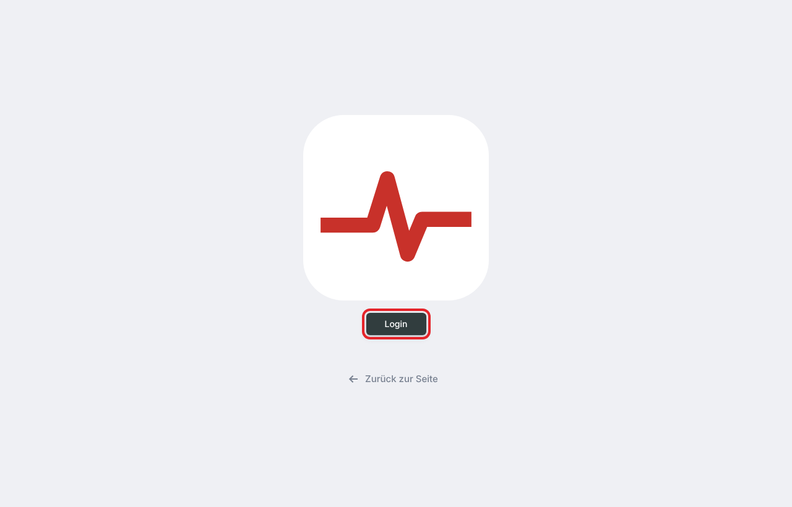

1. Нажать **«Mit GitHub einloggen»** — так называется кнопка, но GitHub-аккаунт **не нужен**.
2. Откроется окошко **«Website bearbeiten»** → ввести пароль → **Anmelden**.
3. Окошко закроется, откроется админка.

## 2. Что где лежит (меню слева)

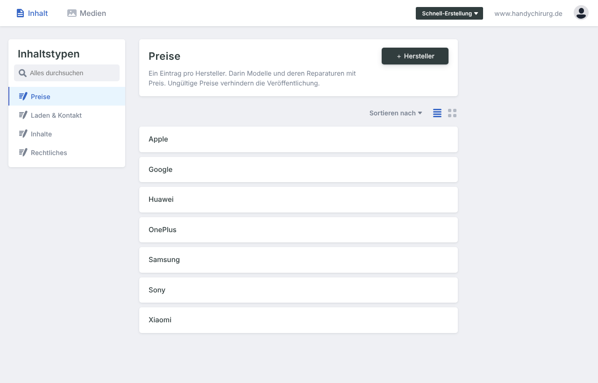

| Раздел | Что там менять |
|---|---|
| **Preise · Apple**, **Preise · Samsung**, … | Список моделей бренда → модель → ремонт → цена. Новое устройство |
| **Laden & Kontakt** | Телефон, e-mail, адрес, часы работы, выходные, **Befund** (цена диагностики), гарантия |
| **Inhalte** | Все тексты сайта: главная, услуги, вопросы (FAQ), Franchise |
| **Rechtliches** | Impressum и Datenschutz (только по согласованию с юристом) |

## 3. Изменить цену

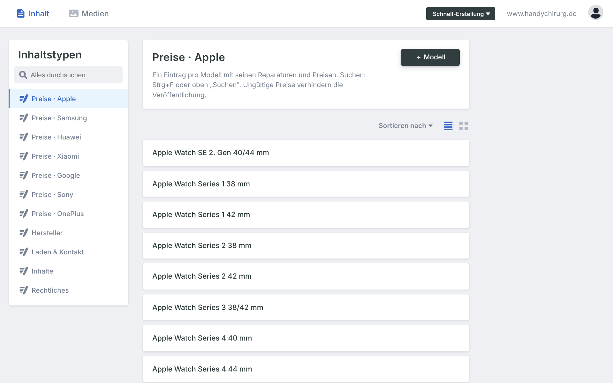

1. **Preise · Apple** (или другой бренд). Найти модель: Ctrl+F → «16 Pro Max».
2. Кликнуть на модель (открывается сразу) → кликнуть на строку ремонта (например «akku»).
3. Поле **«Preis in €»** → новая цена (только число).

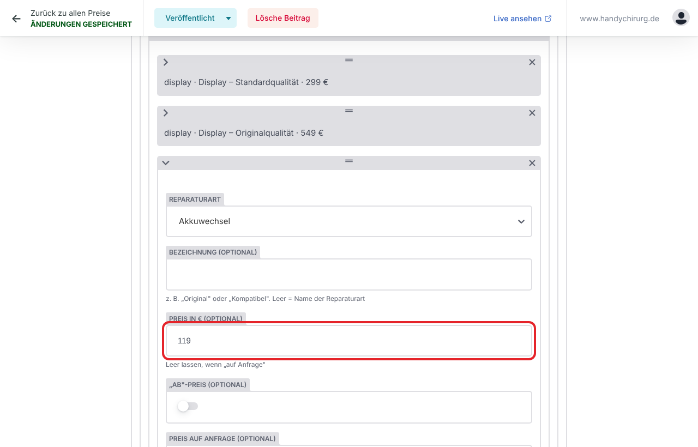

4. Вверху **Veröffentlichen → Jetzt veröffentlichen**.

Цена меняется сразу везде: калькулятор, страница модели, прайс-лист.

## 4. Новое устройство

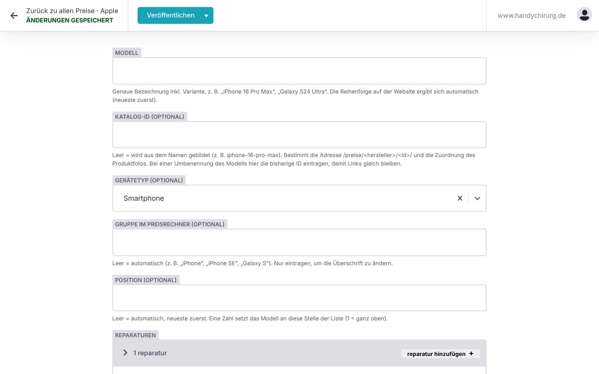

**Preise · бренд** → вверху **«＋ Modell»** → название модели → **«Reparatur hinzufügen»** → вид ремонта + цена → **Veröffentlichen**.

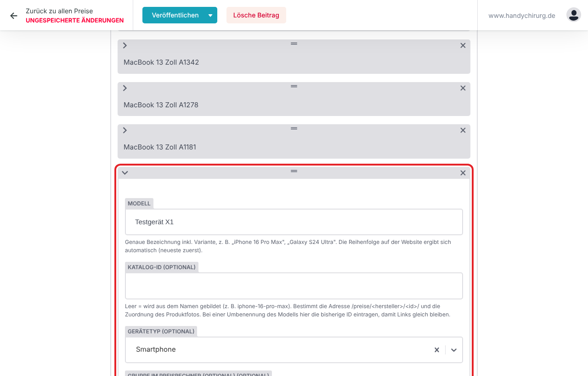

## 5. Фото телефона

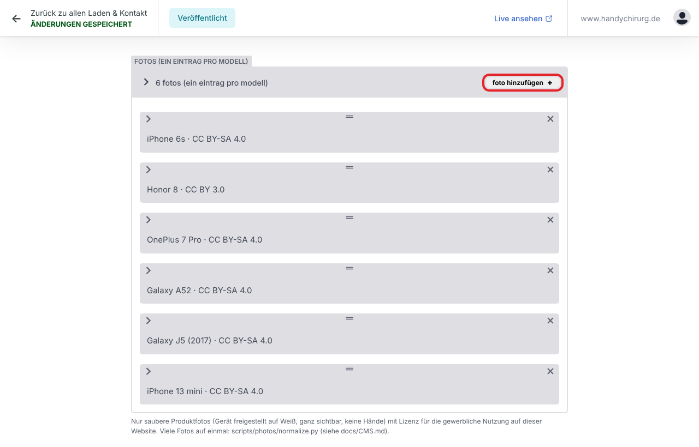

Фото хранится в самой модели: **Preise · бренд** → модель → раскрыть поле **«Produktfoto»**.
1. **Foto:** «Wähle ein Bild» → **«Hochladen»** → файл с компьютера → «Ausgewähltes Element verwenden».
2. **Lizenz:** откуда фото (например «eigenes Foto»). Без этого фото не покажется.
3. **Veröffentlichen.**

**Заменить фото:** в поле «Produktfoto» → «Wähle ein anderes Bild».

**Вкладка «Medien»** (вверху): все загруженные картинки, там же можно удалить лишние.

**Какие фото подходят:** телефон целиком, на белом фоне, без рук; именно эта модель; свои или купленные фото, не из Google.

**Фото Apple/Samsung, которые сейчас стоят:** у них выключено **«Nutzungsrecht bestätigt»**. На настоящем домене они не покажутся, пока нет разрешения от Apple/Samsung. Есть разрешение — включить переключатель. Нет — заменить своими фото.

## 6. Часы работы и Befund

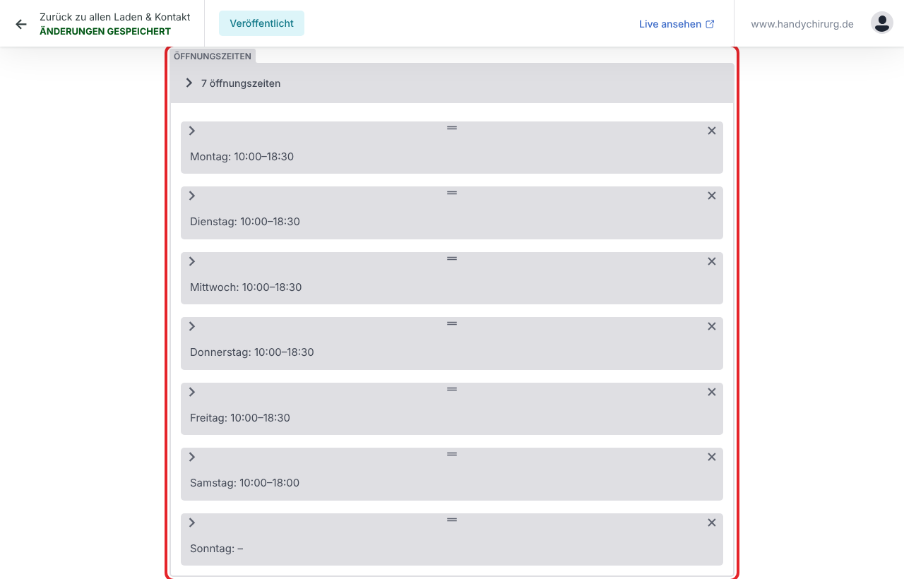

**Laden & Kontakt** → **Kontakt, Öffnungszeiten, Schließtage**:
- **Öffnungszeiten:** день → «Geöffnet» вкл/выкл → время «Von/Bis» в виде `10:00`.
- **Besondere Schließtage:** отпуск, праздники → «Schließtag hinzufügen».
- **Fehleranalyse → Preis in €:** цена Befund (сейчас 25).

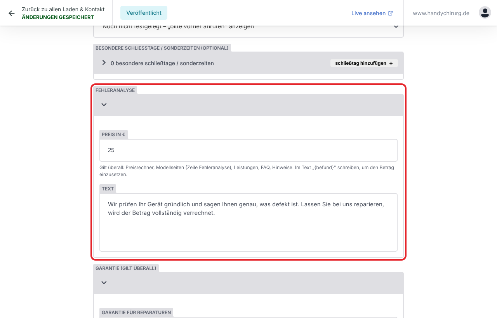

## 7. Тексты

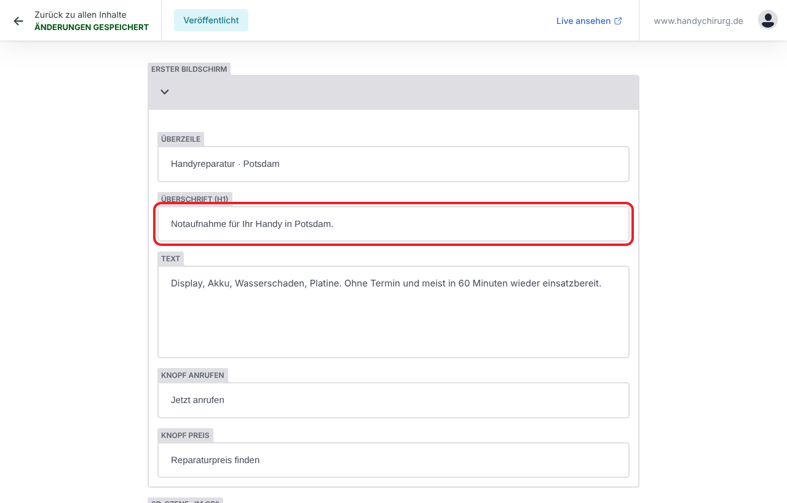

**Inhalte** → нужный раздел → кликнуть в поле → изменить → **Veröffentlichen**.
Слова в фигурных скобках (`{befund}`, `{garantie}`) **не трогать**: туда сайт сам подставляет цену и гарантию.

## 8. Сохранить

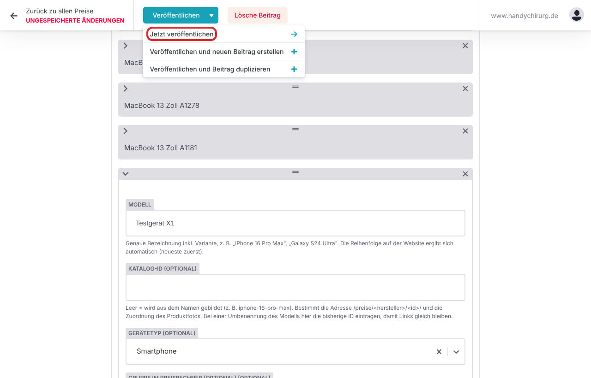

Вверху **«Veröffentlichen»** → **«Jetzt veröffentlichen»**. Сверху появится «Änderungen gespeichert».
Пока видно «Ungespeicherte Änderungen», ничего не сохранено.
Красное поле — неверный формат (например `10.00` вместо `10:00`), исправить и сохранить снова.

## 9. Когда изменения видны на сайте

- Сохранение происходит **сразу**.
- Сайт **сам** пересобирается: через **2–3 минуты** изменение на сайте.
- Если через 10 минут не видно — значит, в правке ошибка (сайт остаётся как был). Написать разработчику.

Проверка: открыть сайт → **Ctrl+F5** → посмотреть, например, в калькуляторе.

## 10. Если не работает

| Проблема | Что делать |
|---|---|
| Окошко с паролем не открывается | Браузер блокирует всплывающие окна: значок в адресной строке → разрешить → снова нажать кнопку |
| «Falsches Passwort.» | Ввести пароль точно (большие/маленькие буквы, дефисы) |
| Висит «Sie werden eingeloggt…» или ошибка | Ctrl+F5 и войти снова. Не помогло — к разработчику: нужно обновить ключ GitHub в Netlify |
| Сохранил что-то не то | Вписать правильное и сохранить снова. Любую старую версию можно восстановить |
