# Website selbst bearbeiten – Anleitung für Handy Chirurg Potsdam

Diese Anleitung zeigt Schritt für Schritt, wie Sie Preise, Geräte, Fotos, Öffnungszeiten und Texte Ihrer Website selbst ändern. Sie brauchen dafür keine technischen Kenntnisse – nur einen Internet-Browser (Chrome, Safari, Firefox oder Edge) am Computer.

> **Stand 04.11.2026:** Die Website läuft unter **https://handychirurg.netlify.app**, die Bearbeitung unter **https://handychirurg.netlify.app/admin/**. Anmeldung nur mit Passwort. Sobald Ihre Domain umgestellt ist, gilt dieselbe Adresse mit Ihrer Domain, z. B. **https://www.handychirurg.de/admin/**.

Die Bilder in dieser Anleitung sind Aufnahmen der echten Bearbeitungsseite. Rote Rahmen zeigen, wo Sie klicken oder etwas eintragen.

---

## 1. Bearbeitungsseite öffnen

Geben Sie im Browser ein: **https://handychirurg.netlify.app/admin/**
(nach der Domain-Umstellung: **https://www.handychirurg.de/admin/**). Tipp: Lesezeichen anlegen.

## 2. Anmelden

1. Klicken Sie auf den Knopf **„Mit GitHub einloggen"** (der Name ist von der Software vorgegeben – Sie brauchen **kein** GitHub-Konto).
2. Es öffnet sich ein kleines Fenster **„Website bearbeiten"** mit dem Feld **Passwort**.
3. Passwort eingeben → **Anmelden**. Das Fenster schließt sich, Sie sehen die Übersicht.

Das Passwort bekommen Sie von Ihrem Betreuer. Geben Sie es niemandem weiter. Bei falschem Passwort steht „Falsches Passwort." – einfach erneut eingeben.

## 3. Die Übersicht

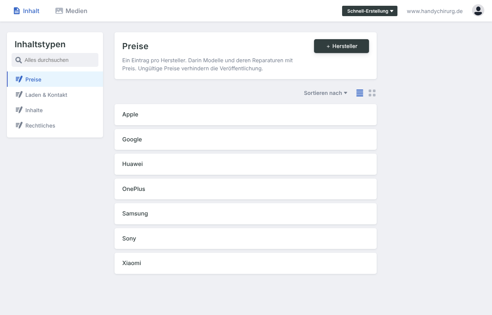

Links sehen Sie vier Bereiche:

| Bereich | Was Sie dort ändern |
|---|---|
| **Preise** | Je Hersteller (Apple, Samsung, …) alle Modelle und ihre Reparaturpreise |
| **Laden & Kontakt** | Telefon, E-Mail, Adresse, Öffnungszeiten, Schließtage, Preis der Fehleranalyse (Befund), Garantie, Produktfotos, Link zu den Google-Bewertungen |
| **Inhalte** | Texte der Startseite und der Unterseiten, Reparaturleistungen, häufige Fragen, Franchise |
| **Rechtliches** | Impressum und Datenschutzerklärung |

## 4. Einen Reparaturpreis ändern

Beispiel: iPhone 16 Pro Max, Akkuwechsel.

**Schritt 1:** Links **Preise** → **Apple** anklicken. Die Modelle stehen in derselben Reihenfolge wie auf der Website (neueste zuerst). Zum Suchen: **Strg + F** (Mac: **⌘ + F**) drücken und „16 Pro Max" eintippen.

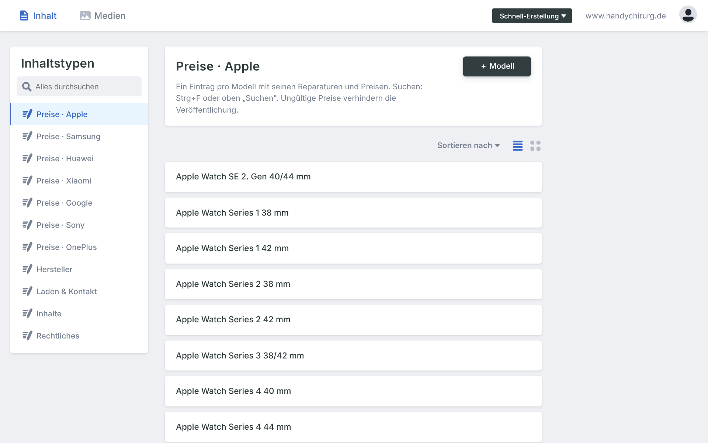

**Schritt 2:** Auf das Modell klicken – es klappt auf. Unter **Reparaturen** die Zeile **„akku …"** anklicken.

**Schritt 3:** Im Feld **„Preis in €"** den neuen Preis eintragen (nur die Zahl, z. B. `129`).

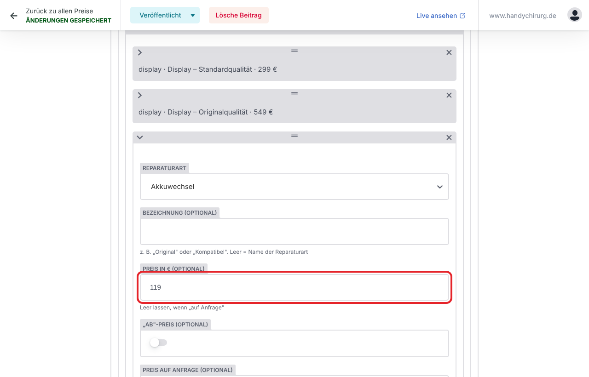

**Schritt 4:** Oben **Veröffentlichen → Jetzt veröffentlichen** (siehe Kapitel 9).

Gut zu wissen:
- **„Display – Standardqualität"** und **„Display – Originalqualität"** sind zwei eigene Zeilen. Jede hat ihren eigenen Preis.
- **„ab"-Preis** einschalten, wenn der Preis „ab … €" angezeigt werden soll.
- **„Preis auf Anfrage"** einschalten und das Preisfeld leer lassen, wenn es keinen festen Preis gibt.
- Der Preis gilt automatisch überall: im Preisrechner, auf der Modellseite und in der Preisliste. Sie ändern ihn nur an dieser einen Stelle.

## 5. Ein Gerät hinzufügen oder ändern

**Neues Gerät:** In **Preise → (Hersteller)** ganz nach unten scrollen bzw. bei „Modelle" auf **„Modell hinzufügen"** klicken.

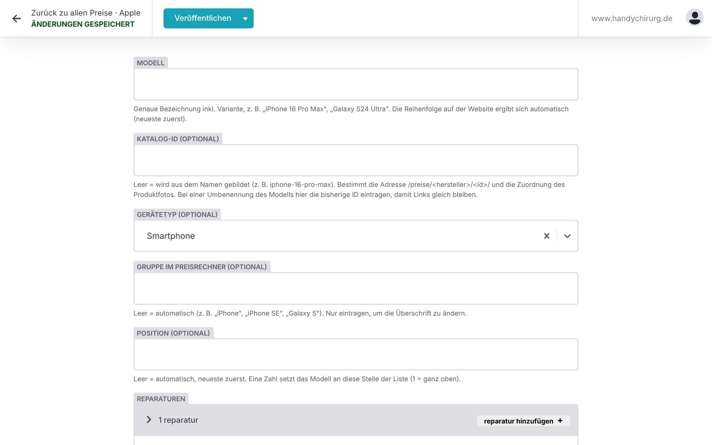

Dann ausfüllen:

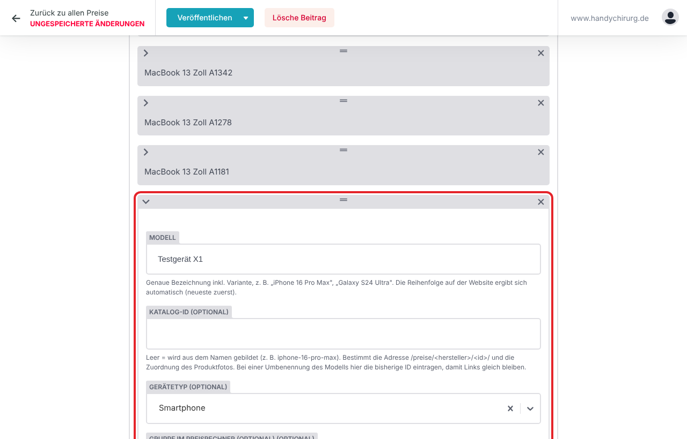

| Feld | Was eintragen |
|---|---|
| **Modell** | Genaue Bezeichnung, z. B. „iPhone 17 Pro" oder „Galaxy S25 Ultra" |
| **Katalog-ID** | Leer lassen – wird automatisch gebildet. Nur bei einer Umbenennung die alte ID eintragen, damit alte Links weiter funktionieren |
| **Gerätetyp** | Smartphone, Tablet, Laptop, Smartwatch … |
| **Gruppe im Preisrechner** | Normalerweise leer lassen (wird automatisch zugeordnet, z. B. „iPhone", „Galaxy S") |
| **Position** | Normalerweise leer lassen (neueste Modelle stehen automatisch oben) |
| **Reparaturen** | Für jede angebotene Reparatur **„Reparatur hinzufügen"** → Reparaturart wählen (z. B. Display) → Preis eintragen |

Danach **Veröffentlichen → Jetzt veröffentlichen**. Das neue Gerät erscheint im Preisrechner, in der Preisliste und bekommt eine eigene Seite.

**Gerät ändern:** Modell aufklappen und die Felder ändern. **Gerät entfernen:** auf das **×** rechts in der Zeile des Modells klicken – bitte nur, wenn Sie das Gerät wirklich nicht mehr reparieren.

## 6. Ein Gerätefoto hochladen oder ersetzen

Links **Laden & Kontakt → Produktfotos im Preisrechner**.

**Neues Foto:** auf **„Foto hinzufügen"** klicken.

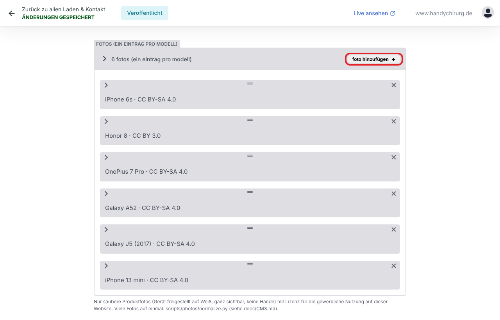

1. **Modell:** Namen eintippen (z. B. „15 Pro") und das richtige Modell aus der Liste wählen.
2. **Foto:** auf **„Wähle ein Bild"** klicken → **„Hochladen"** → Datei vom Computer wählen → **„Ausgewähltes Element verwenden"**.
3. **Lizenz:** eintragen, woher das Foto stammt und dass Sie es verwenden dürfen (z. B. „Eigenes Foto", „Gekauft bei iStock, Lizenz Standard", „Genehmigung Samsung vom …"). Dieses Feld ist Pflicht.
4. **Bildnachweis** nur ausfüllen, wenn die Lizenz eine Namensnennung verlangt – er wird dann unter dem Foto angezeigt.
5. **Veröffentlichen → Jetzt veröffentlichen.**

**Foto ersetzen:** den Eintrag des Modells aufklappen → **„Wähle ein anderes Bild"** → neues Bild hochladen → veröffentlichen.

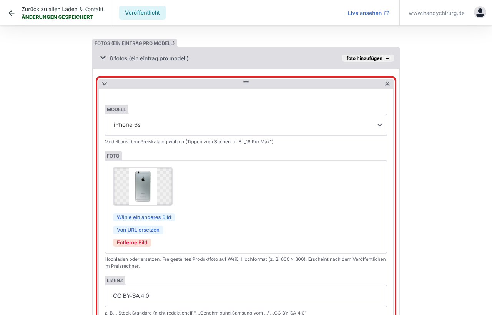

Bitte nur:
- **saubere Produktfotos**: das ganze Gerät, freigestellt auf weißem oder hellem Hintergrund, ohne Hände, ohne Werkstatt, ohne Werbung;
- **genau das richtige Modell** (ein iPhone 15 ist kein iPhone 15 Pro);
- Fotos, die Sie **verwenden dürfen** – eigene Fotos, gekaufte Fotos ohne „nur redaktionell", oder mit schriftlicher Genehmigung. Fotos von Apple- oder Samsung-Seiten und aus der Google-Bildersuche dürfen Sie ohne Genehmigung **nicht** verwenden.
- Am besten im Hochformat, z. B. 600 × 800 Pixel.

Hat ein Modell kein Foto, zeigt der Preisrechner automatisch eine Zeichnung des Telefons. Das ist kein Fehler.

## 7. Öffnungszeiten und Befund-Preis ändern

Links **Laden & Kontakt → Kontakt, Öffnungszeiten, Schließtage**.

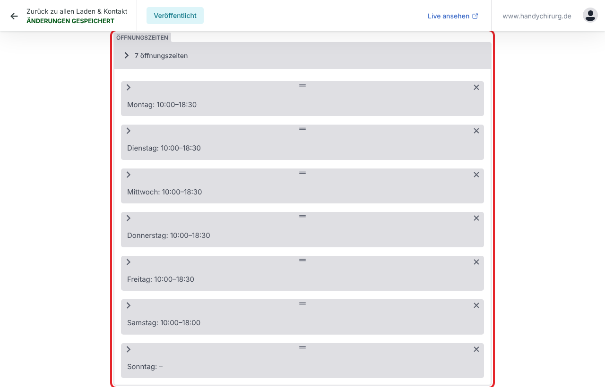

- **Öffnungszeiten:** den Tag anklicken → **„Geöffnet"** ein- oder ausschalten → **Von** und **Bis** im Format `10:00` eintragen.
- **Besondere Schließtage / Sonderzeiten:** für Urlaub oder Feiertage → **„Schließtag hinzufügen"** → Datum und Bezeichnung (z. B. „Betriebsurlaub").
- **An gesetzlichen Feiertagen:** wählen, ob der Laden geschlossen, geöffnet oder „bitte vorher anrufen" angezeigt wird.

Die Zeiten erscheinen automatisch überall: oben in der Kopfzeile („Jetzt geöffnet"), in der Fußzeile, auf der Startseite und für Google.

**Befund / Fehleranalyse:** weiter unten im selben Bereich, Feld **„Preis in €"** (zurzeit 25).

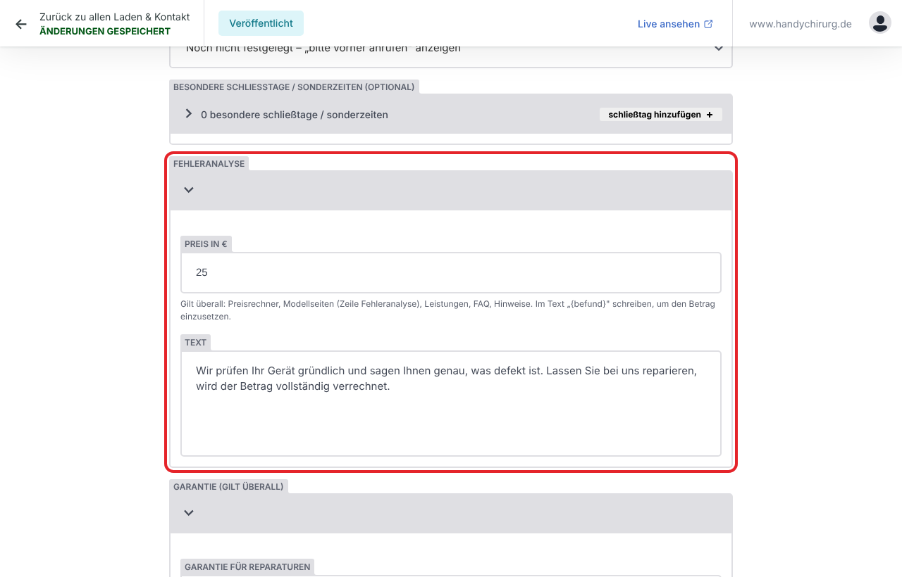

Der Betrag erscheint automatisch überall, wo der Befund genannt wird (Preisrechner, Modellseiten, Leistungen, häufige Fragen).

Im selben Bereich finden Sie auch **Telefon, E-Mail, Adresse**, die **Garantie** (zurzeit „3 Monate", Wasserschaden „Ohne Garantie") und die **Social-Media-Links**.

## 8. Texte ändern

Links **Inhalte** und dann den Bereich wählen:

| Bereich | Inhalt |
|---|---|
| **Startseite – Texte** | Überschriften, Texte und Knöpfe der Startseite |
| **Unterseiten – Überschriften und Suchmaschinen** | Überschriften der Preisliste, des Preisrechners und der Fehlerseite; Seitentitel und Beschreibung für Google |
| **Fachbereiche (Leistungen)** | Die Leistungs-Kacheln auf der Startseite |
| **Reparaturleistungen (Seite /leistungen/)** | Die Seite /leistungen/ |
| **Häufige Fragen** | Fragen und Antworten |
| **Franchise** | Die Franchise-Seite |

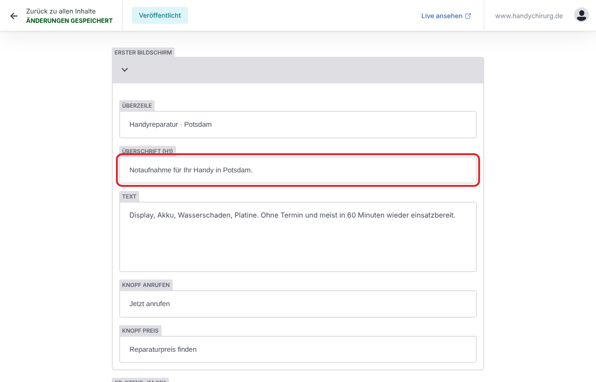

Einfach in das Feld klicken, Text ändern, veröffentlichen.

**Platzhalter in geschweiften Klammern** bitte stehen lassen: `{befund}` wird automatisch durch den Befund-Preis ersetzt, `{garantie}` durch die Garantie, `{garantieWasser}` durch „Ohne Garantie", `{gewaehrleistung}` durch den Satz zu Ihren gesetzlichen Pflichten. So stimmen die Angaben überall.

**Impressum und Datenschutz:** links **Rechtliches**. Änderungen dort bitte nur nach Rücksprache mit Ihrem Rechtsberater.

## 9. Speichern und veröffentlichen

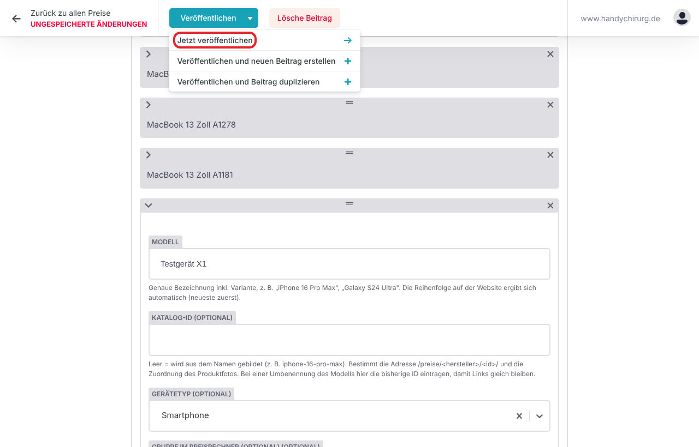

1. Oben auf **„Veröffentlichen"** klicken.
2. Im Menü **„Jetzt veröffentlichen"** wählen.
3. Oben links steht danach **„Änderungen gespeichert"**.

Erst mit „Jetzt veröffentlichen" wird gespeichert. Solange oben **„Ungespeicherte Änderungen"** steht, ist noch nichts gespeichert. Schließen Sie die Seite nicht vorher.

**Rot markierte Felder** haben ein falsches Format (z. B. Uhrzeit `10.00` statt `10:00`, Preis mit Buchstaben). Dann wird nicht gespeichert – korrigieren und erneut veröffentlichen.

## 10. Prüfen, ob die Änderung online ist

Nach „Jetzt veröffentlichen" ist Ihre Änderung **sofort gespeichert**. Auf der Website erscheint sie, sobald die Website neu aufgebaut ist:
- **Zurzeit** baut Ihr Betreuer die Website neu auf – sagen Sie ihm kurz Bescheid, was Sie geändert haben.
- Sobald die automatische Aktualisierung eingerichtet ist, erscheint die Änderung nach **etwa 1–2 Minuten** von selbst.

So prüfen Sie: **https://handychirurg.netlify.app** öffnen, mit **Strg + F5** (Mac: **⌘ + Umschalt + R**) neu laden, die Stelle ansehen, z. B. im **Preisrechner** das Gerät wählen.

## 11. Wenn etwas nicht klappt

| Problem | Was tun |
|---|---|
| Das Anmeldefenster öffnet sich nicht | Der Browser blockiert Pop-ups. Oben in der Adresszeile auf das Symbol klicken und **Pop-ups für diese Seite erlauben**, dann erneut „Mit GitHub einloggen" |
| „Falsches Passwort." | Passwort genau so eingeben, wie Sie es bekommen haben (Groß-/Kleinschreibung, Bindestriche) |
| Nach dem Passwort bleibt „Sie werden eingeloggt…" stehen oder es kommt eine Fehlermeldung | Seite mit Strg + F5 neu laden und noch einmal anmelden. Hilft das nicht: Ihren Betreuer informieren (der Zugangsschlüssel muss erneuert werden) |
| Felder sind rot, Veröffentlichen geht nicht | Format korrigieren (Uhrzeit `10:00`, Telefon `+491632288224`, Preis nur Zahl) |
| Veröffentlicht, aber nach 5 Minuten nicht online | Seite mit Strg + F5 neu laden. Ist es dann noch alt, hat die Prüfung beim Neuaufbau einen Fehler gefunden – **die Website bleibt in diesem Fall unverändert online**, nichts geht kaputt. Bitte Ihren Entwickler informieren (welches Feld Sie geändert haben) |
| Versehentlich etwas Falsches veröffentlicht | Einfach den richtigen Wert eintragen und erneut veröffentlichen. Jede Änderung wird gespeichert; Ihr Entwickler kann jeden früheren Stand wiederherstellen |
| Seite lädt sehr langsam | Bei Samsung und Apple sind viele Modelle hinterlegt – das Öffnen kann einige Sekunden dauern. Bitte warten, nicht mehrfach klicken |

**Ihr Entwickler:** _(Name, Telefon, E-Mail hier eintragen)_
